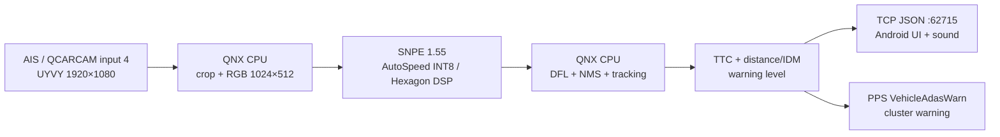

# Устройство F515 ADAS QNX 0.1.5

## Поток данных

Android и QNX — разные системы на одном ГУ. Модель не выполняется в Android.
Прикладной TCP-канал передаёт результаты, а не изображения; рамки на экране
приложения — схема кадра. Диагностический replay может отдельно подавать RGB
в QNX через TCP вместо камеры.

## Захват и инференс

`capture.cpp` открывает AIS-вход 4 через QCARCAM 4.7. У тестовой прошивки элемент
списка входов имеет размер 320 байт при 316 байтах базовой структуры заголовка:
обёртка добавляет padding. Размеры основных структур контролируются `static_assert`.
Буферы выделяются через штатный pmem API и передаются камере как handles.

Камера выдаёт UYVY 1920×1080 примерно 30 кадров/с. Обработка ограничена 15 кадрами/с.
`preprocess.cpp` обрезает верхние 120 строк и формирует RGB 1024×512 с нормализацией.
Последовательное копирование строк из некэшируемого camera buffer в обычную память
убирает дорогие разрозненные чтения; в ранней реализации они занимали около 200 мс.

`snpe_runner.cpp` использует штатный SNPE 1.55 и Hexagon DSP. CPU fallback отключён:
проблема с DSP должна быть видна как ошибка, а не скрытая тяжёлая нагрузка Android/CPU.
Модель имеет шесть выходов: отдельно DFL и классы на трёх масштабах 8/16/32.
DFL-декодирование, пороговая фильтрация, NMS и перенос координат в полный кадр
выполняются на QNX CPU. Причины преобразования графа описаны в [models/README.md](../models/README.md).

## Два канала предупреждения

### TTC по изменению рамки

`tracker.cpp` сопоставляет объекты по IoU (порог 0,3), хранит историю ширины рамки
и оценивает наклон `ln(width)` по времени. Для положительного наклона TTC равен
обратной величине наклона. Окно — 1,5 с, минимум 8 точек, минимальная значимость
наклона — 3. Пороги TTC: 3 с для предупреждения, 2 с для тревоги; требуется
подтверждение в течение трёх кадров.

Оценивается также время выхода объекта из коридора. Если он покинет коридор раньше
расчётного столкновения, предупреждение подавляется. Геометрия коридора задана
для текущей камеры: центр 0,515 ширины кадра, горизонт 0,50 высоты, капот 0,95;
полуширина расширяется от 0,03 до 0,34 ширины. Это фиксированная настройка,
не самостоятельный детектор полосы.

### Дистанция и IDM

`vp_fcw.cpp` переносит подход Vision Pilot: выбор ближайшего CIPO класса 1,
эвристика cut-in для класса 2, проекция нижней точки рамки на плоскость дороги,
фильтр частиц (500 частиц) для расстояния и скорости сближения, затем IDM.
Калибровка: `K=1820`, горизонт `y=540`, центр `x=989`, высота камеры 1,51 м.

Параметры IDM: `a=1.5`, `b=3`, `T=1.5`, `s0=2`; уровни при требуемом замедлении
−3 и −5 м/с². Этот канал включается при известной скорости от 5 км/ч. По сравнению
с использованной исходной реализацией изменён знак относительной скорости и убран
член свободной дороги, зависящий от желаемой скорости. В коде оставлен `vp_sign`
для сопоставления поведения.

Итоговый уровень учитывает оба канала. Термин `AEB` в именах некоторых полей
означает второй уровень расчётного предупреждения. **Команд торможения нет.**

## Скорость, приборка и звук

QNX читает PPS `VehicleGauges`; текущая гипотеза раскладки скорости использует
первые два байта в big endian. Проверка на стоящем ГУ недостаточна, чтобы считать
эту раскладку подтверждённой в движении. Android отдельно показывает VHAL
`SPEED_DISP` через `app_process` для сравнения. Эти показания не подаются обратно
в QNX вместо PPS.

При включённом баннере QNX пишет `VehicleAdasWarn`. Для обоих уровней выбран код
`07 01` (`BwE=`), снятие — `ff 00`. Соответствие тексту «Риск столкновения» выведено
из таблиц прошивки; окончательное визуальное подтверждение при зажигании остаётся
отдельной проверкой. Код текста «Экстренное торможение» по умолчанию не используется.

Первый уровень Android показывает визуально. Для второго используется исходный
FCW-зуммер: три импульса по 70 мс, паузы 40 мс, смесь 2400/1200 Гц 70/30,
через навигационный аудиоканал. Повтор — не чаще одного раза в 1,8 с. Выключение
звука, снижение уровня или потеря связи прекращают предупреждение.

## Связь и жизненный цикл

`fcwd` подключается к Android `172.16.1.3:62715`. TCP выбран в диапазоне
60000–65000, который пропускает штатный Android firewall. Формат — JSON-строки;
точная сериализация находится в `native/src/fcwd.cpp`, разбор — `FcwdFrame.java`.
Передаются метаданные кадра, объекты, скорости, TTC и состояние каналов. При
разрыве выполняется переподключение; медленный получатель не должен останавливать
распознавание. Диагностические UDP-получатели сохранены в исходниках отдельно.

`FcwdLinkService` — foreground service Android. Кнопки запуска/остановки и
обработчик автозапуска используют общий `QnxControl.CONTROL_LOCK`. Перед стартом
повторно проверяется, разрешён ли ещё автозапуск, поскольку установка модели
может занять время. Перед заменой исполняемого файла ожидается остановка процесса.
Повторные события загрузки/обновления не должны создавать второй демон.

## Развёртывание на QNX

Доступ: локальный root-adbd Android `127.0.0.1:5555`, затем telnet QNX
`172.16.1.5`. Это внутренние адреса ГУ, не адреса сервера обновлений.
ADB-ключ берётся из APK; в публичной сборке он принадлежит тому, кто её собрал.

`QnxPayload` проверяет manifest и локальные assets. `QnxDeployer` формирует
постоянный каталог `/var/log/fcw/apk_<идентификатор manifest>/`. Проверяются
содержимое, размер и права; повреждённые объекты сохраняются как `.broken_*`.
Файлы сначала записываются под временными именами, проверяются на стороне QNX,
затем получают нужные права и окончательные имена.

Основной путь — точный NFS export `172.16.1.5:/var/log` в
`/mnt/qnxshare/var/log`. На тестовой прошивке штатный `cp` мог вернуть успех,
оставив файл длиной 0. Даже создание нового файла через `dd` могло завершиться
`ENOENT`. Поэтому incoming-файл сначала создаётся на QNX, получает права на
запись, затем Android записывает в него через root busybox `dd conv=notrunc`
и выполняет `sync`. Результат всё равно проверяется по SHA-256 на QNX.

При сбое используется telnet: foreground `openssl base64 -d -out ...`, отключённое
эхо, поток base64 из Android и **Ctrl-D** для EOF. Завершение подтверждается
отдельным маркером, а данные — отдельной проверкой хэша. Heredoc здесь намеренно
не используется: интерактивный QNX shell вновь включает эхо при чтении heredoc,
и передача большой модели блокируется на заполненных двунаправленных буферах.

Постоянная копия находится на `/var/log`; запуск идёт из `/dev/shmem/fcwd`,
так как постоянный раздел не позволяет исполнение. Модель передаётся явным
параметром `dlc=...`. `shmem` очищается при перезагрузке, постоянные assets сохраняются.

## Облачное обновление и разрешения

JSON: `https://tm.dsr.su/f515/adas-qnx/latest.json`. Разрешён HTTPS и конкретный
host/path, редиректы не принимаются. Ограничения: JSON 64 КиБ, APK 64 МиБ.
Проверяются размер и SHA-256 загрузки, пакет, версия и совпадение подписантов.
PackageInstaller Session API запрашивает системное подтверждение; отдельный
manifest receiver сохраняет результат для следующего открытия приложения.

Выдача прав ограничена текущим Android-пользователем и собственным пакетом:
установка обновлений и исключение из battery optimization. На прошивке смена
appop может завершить приложение даже при повторной записи того же значения.
Поэтому уже разрешённый appop пропускается, а первая выдача выполняется отдельной
root-командой с возвратом MainActivity.

Обновление APK не прерывает уже работающий QNX-процесс. Новый комплект применяется
при следующем запуске `fcwd`; автоматическая подмена исполняемых байтов под
работающим процессом не выполняется.
